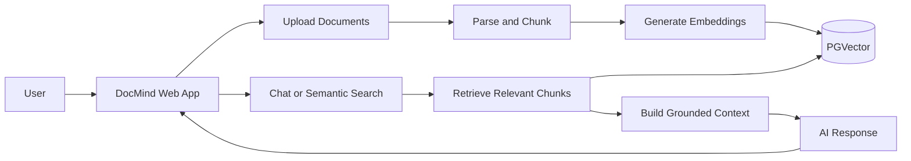

# DocMind

> **Turn your documents into an interactive knowledge partner.**

DocMind is an AI document intelligence assistant for understanding technical documents, manuals, contracts, reports, and software engineering materials. Upload your files, explore their content, search by meaning, and have natural conversations grounded in the information that matters.

DocMind combines document-grounded answers with broad general knowledge, making it useful both for precise source-based research and flexible everyday questions.

## Why DocMind

- **Ask instead of browse** — Get direct answers from your documents in a conversational workspace.
- **Trust the context** — Responses include source citations, document names, page numbers, and relevant excerpts.
- **Search by meaning** — Find concepts, clauses, facts, definitions, and related passages without relying only on exact keywords.
- **Keep exploring** — Inspect indexed vector chunks to understand how your documents are represented and retrieved.
- **Work naturally** — Receive clear, structured Markdown responses with formatted lists, tables, quotations, and syntax-highlighted code.

## Product experience

### AI document chat

Ask questions about one selected document or across your document library. DocMind supports both standard responses and real-time streaming answers, with conversation history for continued research.

### Multi-document workspace

Upload multiple PDF, DOCX, TXT, Markdown, or CSV files through a drag-and-drop interface. Upload progress, processing status, file metadata, page counts, and indexed chunk counts are visible in the workspace.

### Semantic search

Search indexed content using natural language. Adjust the number of results and minimum similarity threshold, then review ranked matches with similarity scores, source pages, snippets, and metadata.

### Vector chunk explorer

Inspect the chunks created during document processing, filter them by text, view metadata, and copy content for further use. This provides transparency into the retrieval layer behind every answer.

### Focused, polished interface

The React frontend provides:

- Secure sign-in and account creation screens
- Responsive dashboard layout with document and chat sidebars
- Document selection for focused Q&A and search
- Conversation history with new, rename, and delete actions
- Streaming mode controls
- Markdown rendering and code syntax highlighting
- Citation cards with expandable source details
- Loading states, upload progress, notifications, and error boundaries
- Mobile-friendly sidebar navigation

## How it works



1. Documents are parsed into readable content.
2. Content is split into searchable chunks.
3. Chunks are converted into vector embeddings and stored for retrieval.
4. A question is matched against the most relevant document content.
5. The AI uses that context to generate a clear answer with citations.

## Technology

### Frontend

- React 19
- TypeScript
- Vite
- Tailwind CSS
- Zustand
- React Router
- Framer Motion
- React Markdown and Prism
- Axios
- React Dropzone

### Backend and AI

- Java 21
- Spring Boot
- Spring Security with JWT authentication
- Spring AI
- Google Gemini chat and embedding models
- PostgreSQL with PGVector
- Apache Tika and PDF document parsing
- Spring Data JPA

## Screenshots

The repository includes interface screenshots in [`frontend/screenshots`](./frontend/screenshots).

## Project structure

```text
Doc_Mind/
├── frontend/
│   ├── docmind-frontend/       # React + TypeScript web application
│   └── screenshots/             # Product screenshots
├── src/main/java/               # Spring Boot backend
├── src/main/resources/          # Application configuration
├── docker-compose.yml           # Local PostgreSQL + PGVector service
└── README.md
```

## Run locally

### Backend

```bash
docker compose up -d postgres
bash mvnw spring-boot:run
```

### Frontend

```bash
cd frontend/docmind-frontend
npm install
npm run dev
```

The frontend is configured for a local development workflow with the Spring Boot API. For deployment, provide the backend's AI and database configuration through your environment or hosting platform.

## Vision

DocMind is built to make dense information easier to understand, search, and use. It transforms static files into an approachable, conversational knowledge space where answers stay connected to the source material while remaining helpful beyond it.
