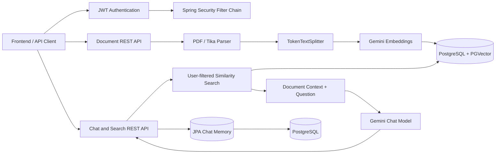

# DocMind

DocMind is a Spring Boot document-intelligence backend that lets authenticated users upload documents, index their content as vector embeddings, search semantically, and ask questions through a retrieval-augmented generation (RAG) pipeline.

## What is implemented

| Capability | Implementation |
|---|---|
| User login and authentication | Registration, BCrypt password hashing, JWT login, stateless Spring Security |
| Multiple document upload | Single and sequential multi-file upload endpoints |
| Document processing and chunking | PDF page parsing, Apache Tika parsing for other supported formats, `TokenTextSplitter` chunking |
| Vector embeddings | Spring AI Google Gemini embedding model (`gemini-embedding-001`) |
| PGVector storage | PostgreSQL `pgvector` store with HNSW index and cosine distance |
| Semantic search | Filtered similarity search with configurable top-k and threshold |
| RAG pipeline | Retrieves relevant chunks, adds source context, and sends the prompt to Gemini |
| AI chat with documents | Normal and Server-Sent Events (SSE) streaming chat, citations, response timing |
| Persistent chat memory | JPA-backed conversations and messages in PostgreSQL |
| Spring Boot backend | REST API, validation, global error responses, OpenAPI/Swagger documentation |

## Architecture



### Request flow

1. A user registers or logs in and receives a JWT.
2. The JWT filter loads the user and places the authenticated `User` in the security context.
3. Uploading creates `DocumentMetadata`, parses the file, splits it into chunks, adds document/user metadata, and writes embeddings to PGVector.
4. Chat and search retrieve chunks using `userId` and, optionally, `documentId` filters.
5. The retrieved text is supplied as document context to the Gemini chat model.
6. Chat messages are persisted by `JpaChatMemory` under a conversation ID, and chat responses include source citations.

## API endpoints

All `/api/v1/**` endpoints require a bearer token unless noted otherwise.

### Authentication

| Method | Endpoint | Purpose |
|---|---|---|
| `POST` | `/api/v1/auth/register` | Create a user account |
| `POST` | `/api/v1/auth/login` | Authenticate and return a JWT |

### Documents

| Method | Endpoint | Purpose |
|---|---|---|
| `POST` | `/api/v1/documents/upload` | Upload and index one document |
| `POST` | `/api/v1/documents/upload-multiple` | Upload and index multiple documents sequentially |
| `GET` | `/api/v1/documents/user` | List documents owned by the authenticated user |
| `GET` | `/api/v1/documents/{id}` | Get document metadata |
| `DELETE` | `/api/v1/documents/{id}` | Delete metadata and matching vector rows |
| `GET` | `/api/v1/documents` | List all documents; admin-only |

PDF files are parsed page by page. Other formats are delegated to Apache Tika; the controller advertises PDF, DOCX, text, Markdown, and CSV support.

### Chat and search

| Method | Endpoint | Purpose |
|---|---|---|
| `POST` | `/api/v1/chat/query` | Ask a question and receive a JSON response with citations |
| `POST` | `/api/v1/chat/stream` | Stream answer content as SSE events |
| `POST` | `/api/v1/chat/search/similarity` | Return matching chunks and similarity citations |

Example chat request:

```json
{
  "question": "What are the main conclusions?",
  "documentId": "optional-document-uuid",
  "topK": 5,
  "minSimilarity": 0.2,
  "conversationId": "optional-conversation-id"
}
```

## Data model

- `users`: credentials, email, and role (`USER` or `ADMIN`).
- `document_metadata`: filename, content type, size, processing status, page/chunk counts, timestamps, and owning user.
- `vector_store`: Spring AI PGVector table containing embeddings, chunk text, and metadata such as `documentId`, `userId`, `fileName`, `chunkIndex`, and `pageNumber`.
- `conversations` and `chat_messages`: persistent conversation history used by Spring AI's chat-memory advisor.

Document processing statuses are `UPLOADING`, `PROCESSING`, `INDEXED`, and `FAILED`.

## Technology stack

- Java 21
- Spring Boot 4.1.2
- Spring Security and JJWT 0.13.0
- Spring AI 2.0.1
- Google Gemini chat and embedding models
- PostgreSQL 16 with `pgvector`
- Spring Data JPA / Hibernate
- Apache Tika and Spring AI PDF reader
- Springdoc OpenAPI / Swagger UI
- Maven

## Run locally

### Prerequisites

- Java 21
- Docker
- A Gemini API key

### Start PostgreSQL with PGVector

```bash
docker compose up -d postgres
```

The database is exposed at `localhost:5434` and initialized as `docmind`. `init.sql` enables the `vector` and `uuid-ossp` extensions.

### Configure environment variables

```bash
export GEMINI_FREE_API_KEY="your-gemini-api-key"
export JWT_SECRET="replace-with-a-long-random-secret"
```

Optional database variables are `DB_HOST`, `DB_PORT`, `DB_NAME`, `DB_USER`, and `DB_PASSWORD`. Defaults match the Docker Compose database.

### Start the application

```bash
./mvnw spring-boot:run
```

The API runs on `http://localhost:8081`.

- Swagger UI: `http://localhost:8081/swagger-ui.html`
- OpenAPI JSON: `http://localhost:8081/v3/api-docs`

Upload limits are 25 MB per file and 50 MB per request.

## RAG and vector configuration

The active development profile configures:

- Embedding dimensions: `1536`
- PGVector table: `vector_store`
- Index: `HNSW`
- Distance: cosine
- Chunk size: `700`
- Default top-k: `5`
- Similarity threshold: `0.0`

These settings are in `src/main/resources/application-dev.yml`. The `AppProperties` class also defines minimum chunk and maximum chunk-count safeguards.

## Security and isolation notes

Authentication is stateless and uses JWT bearer tokens. Uploaded chunks receive the authenticated user's ID, and chat/search vector retrieval applies a `userId` filter. User document listing is also scoped through `findByUserOrderByCreatedAtDesc`.

Before production use, document ownership checks should also be enforced in `GET /api/v1/documents/{id}` and `DELETE /api/v1/documents/{id}`. Those service methods currently look up documents by ID without the authenticated user, so a user who knows another document ID may access or delete it. Chat memory creation should likewise always associate a newly created conversation with its authenticated user, and the non-streaming chat method should reuse one generated conversation ID consistently for persistence, the advisor, and the response.

Other production hardening items include replacing the development JWT fallback secret, restricting the wildcard CORS origin, validating registration fields consistently, and avoiding `show-sql`/verbose framework logging outside development.

## Project layout

```text
src/main/java/com/project/doc_mind/
├── config/       Security, JWT filter, CORS, application configuration
├── controllers/  Authentication, document, chat, and search endpoints
├── dto/          API request and response models
├── entity/       Users, documents, conversations, and chat messages
├── repository/   Spring Data JPA repositories
├── service/      Parsing, ingestion, RAG, JWT, user, and chat-memory services
└── exception/    Domain exceptions and REST error handling
```

Additional design notes are available in `docs/CHAT_MEMORY_DB_ARCHITECTURE.md`, `docs/USER_DOCUMENT_ISOLATION_ANALYSIS.md`, and `docs/FRONTEND_BUILD_PROMPT.md`.
